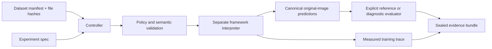

# Architecture

The unit of standardization is the **experiment and its evidence**, not the model's
internal architecture. This foundation has a small controller, versioned contracts,
framework-native workers, evaluator adapters, and durable artifacts. It has no
custom CUDA layer, universal optimizer abstraction, or distributed scheduler.

## Boundaries

The core imports Pydantic and the Python standard library. Heavy model libraries
are imported only inside native worker operations. COCO evaluation imports NumPy
and pycocotools only when explicitly selected. The built-in diagnostics need neither.

Both controller and worker validate input contracts and file hashes. The worker
returns a structured response but success is not trusted until the controller
loads and validates a complete prediction artifact. The controller records the
actual worker environment and implementation digest, not just a desired environment.

The launcher uses a trusted interpreter and known module, a list of arguments,
no shell, a restricted environment, bounded stdout, deadlines, exit status checks,
and POSIX process-group termination. These are reliability controls, not secure
execution of hostile code. Windows termination has not been independently tested
and does not certify descendant-process cleanup.

## Native model boundary

The conformance worker uses torchvision's actual Faster R-CNN implementation:
learned backbone, RPN, proposals, ROIAlign, classification and box regression.
The backbone has two small convolutional layers, with compact ROI heads. This
provides a practical CPU execution oracle without downloading weights. It is
not the standard ResNet/FPN model and must not be given that model's benchmark score.

RGB conversion is worker-owned. Inputs become float tensors in [0,1], followed by
explicit model-owned resize/normalization. torchvision restores predicted boxes
to original dimensions. The controller does not apply a second resize/normalization.
EXIF-rotated images are rejected rather than silently changing annotation geometry.

## Heritage boundary

The MMDetection worker calls native `init_detector` and `inference_detector` in
its configured environment. Static core inspection never executes Python configs.
An explicit category map converts labels without renaming the dataset taxonomy.
Raw native predictions and canonical predictions are both retained. There is no
state-dict conversion or broad config importer in this version.

The supplied upstream/revision are declarations until independently verified.
The current build could not execute this worker against MMDetection. It is an
implemented, unverified integration, not a compatibility certificate.

## What is deliberately not unified

Optimizer internals, training-runtime hooks, foundation-model tokenizers, CUDA ops,
ONNX graphs, simulators, asset catalogs, and geospatial reprojection remain owned
by their original ecosystems. A future adapter must demonstrate a new workflow
before expanding the core. See ADR-001 and the stop/redirect assessment.
